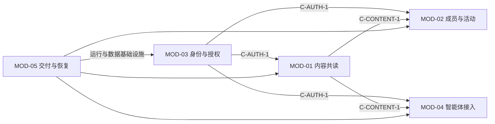

# 聊也读书 · AI-native 开发拆解

版本：1.0 · 日期：2026-10-15 · 方法依据：`ai-native-density-development` v2.4。

这份拆解将 [PRD](PRD.md) 的业务结果映射到 [架构](技术架构.md)、模块、硬节点、任务和证据。采用模板字段并合并为少量有用文档，没有生成需要逐个填空的全套治理文件。

方法适配置信度：93%；下一阶段排期置信度：80%。依据是当前模块与可验证业务边界清晰，未知项是具体 Owner、试点参与者和可投入工时。任务大小是单人一次工作循环的估算，不是日历交期或费用承诺。

## 1. 控制卡：建议 L2-A2，不等于已全部达标

| 维度 | 判断 |
| --- | --- |
| L2：标准骨架 | 面向社群持续维护、共享数据和外部智能体接入，有真实生产权限；需版本化契约、角色边界、日志、发布恢复 |
| A2：有边界的委托 | AI 可在既有 Spec 内计划、实现、验证；目标／权限／重大取舍和发布责任由人承担，沿用已有有效授权 |
| 当前差距 | 缺独立审阅、CI、恢复演练、完整审计、真实用户和成本证据，不能宣称已通过完整 L2 验收 |
| 责任 | 产品与发布责任人为社群主理人；具体运营／技术 Owner 待指定，本文不虚构人员 |
| 开发 AI | 编写文档、实现小任务、测试和诊断；不因写了本文件自动获准扩大生产动作 |
| 产品 AI | Draft 权限，只读公开内容、写待审草稿；不发布、不投票、不读问答 |
| 提升／降低 | 支付、高敏数据或难恢复动作需局部加严；A3 必须有授权、预算、监测、停止、恢复与独立验证证据；重大失败可降低自主度 |

无新增功能需要在本次完成前确认。后续提案集中在 [Decision Registry](ai-native/16-DECISION-REGISTRY.md)，只在真正启动受影响任务时处理，不要求重批已有功能。

## 2. 两个区与五个动作

约束治理区负责目标、Spec、数据权属、接口、体验、预算和边界；自主执行区在框内完成工作并提交证据。新发现可随时返回前一步，五个动作不是一次性瀑布。

| 动作 | 在本站做什么 | 输入 → 工件 | 通过条件／回退 |
| --- | --- | --- | --- |
| Diagnose 诊断 | 判断缺的是内容、使用需求还是工程能力 | 真实材料、任务耗时 → PRD 背景／指标 | 没有真实材料先缩小试点，不用加 AI 功能掩盖 |
| Frame 定框 | 锁定本轮用户结果、禁区、权限与预算 | Spec、DEC → 契约、Owner、HN、验收 | 未决核心规则不进入实现；保留已有授权 |
| Fill 填充 | 按业务模块端到端完成一个小任务 | 最小工件包 → Diff、配置、操作步骤 | 不越过接口或生产授权；不按前后端制造长期等待链 |
| Verify 验证 | 做正例、反例、越权和恢复核验 | AC、测试、线上证据 → PASS/FAIL/NOT-TESTED/N/A | 必需项 FAIL／NOT-TESTED 时不能整体 PASS |
| Compound 沉淀 | 记录实际收益、失败与可复用结论 | 试点台账、故障复盘 → 契约／清单更新 | 按一个瓶颈选择下一轮；尚未复用的产物不算“已验证复用” |

当前这一轮完成的是 Diagnose、Frame 和现状 Verify；没有把下一阶段 Fill 写成已完成。

## 3. Module Capsules：按业务能力承担纵向责任

以下为逻辑责任模块，并非已经拆成独立服务。每个模块只有一个负责结果的 Owner 角色；一个人可以承担多个模块。Owner 人选及备份尚未落实（DEC-01）。

| 模块／唯一 Owner 角色 | 完整纵向责任：UI → API → 规则 → 数据 → 测试 → 运维文档 | 契约与边界 | 最小上下文 |
| --- | --- | --- | --- |
| MOD-01 内容共读／内容运营 Owner | 书架、心得、投稿、审核；submissions/admin content；周期与状态；content；AC-01/02/04；运营手册 | 提供 C-CONTENT-1（类型、状态、周期、来源）；消费 C-AUTH-1；禁止 Agent 直发 | PRD FR-01/02/04、validation、App/components、两处理器内容分支、HN-01/03 |
| MOD-02 成员与活动／社群互动 Owner | 入群问答、活动卡；join/vote/settings；身份、门槛；members/votes/settings 与活动内容；AC-03/06；群人数操作 | 提供 C-COMMUNITY-1；消费 C-CONTENT-1、C-AUTH-1；不处理场地报名 | PRD FR-03/06、joinSchema、活动组件、vote/state/settings、HN-04/05 |
| MOD-03 管理身份与授权／权限 Owner | 登录与双角色 UI、令牌面板；login/logout/dashboard/keys；会话与角色；management_sessions/agent_keys；AC-05；管理权限说明 | 提供 C-AUTH-1；向 MOD-01/02 提供授权判断，向 MOD-04 提供 Agent 凭证；禁止客户端授予角色 | Admin、types、两处理器鉴权、角色迁移、HN-02/06 |
| MOD-04 个人智能体接入／集成 Owner | 智能体指引；agent content/drafts、MCP；只读／草稿；消费 content 与 agent_keys；AC-07；agent-guide | 提供 C-MCP-1，消费 C-API-1/C-CONTENT-1/C-AUTH-1；不托管模型 | integrations、public/agent-guide、Agent API 分支、SDK 测试、HN-01/06 |
| MOD-05 交付与恢复／技术交付 Owner | 用户可用性、运行状态；health/assets；绑定／迁移；D1/构建资源；AC-08；部署、备份与恢复 | 提供 C-DEPLOY-1；消费所有模块契约；不能把代码回滚当数据恢复 | cloud/build/manage、wrangler、schema/migrations、测试适配器、部署说明、HN-07 |

胶囊补充约定：各 Owner 负责其 UI/API/规则/数据/测试/文档同步、受影响消费者通知及异常接管；技术交付 Owner 协调故障，主理人最终指定接管人。当前所有模块逻辑 Active，责任分配仍为 Draft。没有安排额外智能体团队。

### 依赖图与变更传播 v1

- 内容周期或字段变化：MOD-01 提供差异；MOD-04 更新工具 Schema／指南，MOD-02 核对活动载荷，MOD-05 核对迁移／回滚，不能只修改表单。
- 鉴权变化：MOD-03 通知所有写入模块，重新测角色切换、越权、Agent 撤销与私有数据输出。
- 迁移变化：MOD-05 收集所有消费者与间接影响，确认备份和兼容部署，再放行相关集成。
- 公共契约变更清单：旧值→新值、直接／传递消费者、Owner、兼容窗口、迁移／回滚、提供方和消费者测试、证据及确认记录。没有变更时不制造空变更单。

逻辑契约编号用于文档追踪，当前没有自动生成的 JSON Schema／OpenAPI 版本发布。接口真实字段以代码与 C-API-1 快照核对，若不一致先纠正规格。

## 4. 九项能力适用性核对

这是一张裁剪检查表，不要求部署九套系统。

| 能力 | 本项目最小充分做法 | 现状 |
| --- | --- | --- |
| 目标与范围 | PRD、P0／P1、明确排除与试点假设 | 文档已建立，业务价值待证据 |
| 领域与规则 | 三类内容、周期、支持门槛、状态与反例 | 实现且核心测试通过 |
| 数据与契约 | Schema/API/MCP、权限、兼容与迁移 | 现状已登记；机器契约和迁移覆盖不足 |
| 体验与视觉 | 书架主路径、明确状态、当前视觉基线 | 有历史浏览器证据，完整可访问性待测 |
| 工具与授权 | 草稿权限、双角色、服务端硬节点 | 核心边界已验证，独立账号待定 |
| 模块与协作 | 一个 Owner 负责完整业务切片；工件交接 | 模块已划分，人选待定 |
| 模型与成本 | D0–D4，最小上下文、重试和时间边界 | 本站运行时无模型；开发成本未计量 |
| 验证与安全 | AC→HN→证据；四种状态；反例与绕过 | 两适配器通过，恢复／压测缺口保留 |
| 发布与复利 | 发布／回滚、备份恢复、真实结果复盘 | 已部署，有导出流程；CI／恢复演练未完成 |

## 5. 小任务队列：提案，不是本次新增开发

先做 TSK-01 的真实运营证据，再按事故风险推进可靠性；后续功能不能仅按任务表自动启动。每项都要能单独完成和验收，证据不足回到治理区。

| ID／优先级 | 可观察结果与范围 | Owner／依赖／估计 | 验收与反例 | 当前状态／停止条件 |
| --- | --- | --- | --- | --- |
| TSK-00 本轮 | 整理现状 PRD、架构、模块、硬节点、任务与证据，修正旧文档入口 | 文档维护；无依赖；本轮 | 链接可达、无秘密、规则吻合代码，不能把待测写成 PASS | 已完成；不改变产品与生产 |
| TSK-01 P0 | 两周真实内容试点，记录每次材料→草稿→审核→发布；不增功能 | 内容运营；DEC-01；按两周窗口 | 按 PRD 指标记成功、失败、人工和返工时间；无材料不编造 | Proposed；未落实参与者时不声称完成试点 |
| TSK-02 P1 | 隔离 D1 恢复演练与核对清单；原生产库只读 | 技术交付；隔离资源与费用确认；1 循环 | 导出→隔离导入→行数／关系／权限核对→演练结论；错目标必须拒绝 | NOT-TESTED；目标不明／费用未定停写 |
| TSK-03 P1 | Agent 草稿增加幂等键，结果不明时可安全复查 | MOD-04，MOD-01/05；API/Schema 影响分析；1–2 循环 | 同键同载荷返回同一草稿；同键不同载荷冲突；断连／并发反例 | Proposed；先锁定键作用域和保留期 |
| TSK-04 P1 | 建立公开健康检查、错误告警与恢复责任清单 | MOD-05；DEC-01、通知渠道授权；1 循环 | 模拟故障收到一次有效告警、恢复去重，不泄露正文／凭证 | Proposed；本次不自动订阅或发消息 |
| TSK-05 P1 | 先在最常用的一款客户端完成真实接入卡 | MOD-04；确认客户端／版本；每款1循环 | 初始化、发现、读、写草稿、私有、撤销；完整链路有证据 | NOT-TESTED；无支持入口就标未支持，不编造配置 |
| TSK-06 条件性 P1 | 如用户需要，给心得增加明确月／周归档 | MOD-01；DEC-02；1–2循环 | 旧心得兼容、跨周期筛选、迁移／回滚、客户端 Schema 同步 | Proposed；需求未定不迁移数据 |
| TSK-07 P1 | 可重复构建、统一发布标识与验证门禁 | MOD-05；已落实私有 GitHub 托管和本地源码安全钩子；其余1–2循环 | 构建产物与版本可追溯；任一必需检查失败阻止发布 | 部分完成：托管与提交安全；CI／统一发布编号仍为 Proposed |
| TSK-08 条件性 P1 | 独立运营账号与个人动作审计 | MOD-03；DEC-03/04，恢复方案；先1循环设计 | 禁止伪造 actor；禁用个人会话有效；迁移不误提权；日志不含秘密 | Proposed；共享口令不能直接映射成虚构个人身份 |

每个循环开工卡至少填写：对应 FR/AC、环境、Owner、允许工具／数据、输入、可观察结果、排除项、HN、成本／时间限额、正反例、恢复步骤、交付证据、Reviewer。复杂到要临时发明核心规则时，任务尚未就绪。

## 6. D0–D4 与 Planner／Worker／Reviewer

| 层级 | 本站适用工作 | 产物／边界 |
| --- | --- | --- |
| D0 确定性代码 | 角色、周期、投票去重、发布状态、限流 | Schema、代码 Guard、SQL 与测试；不得交给模型自由判断 |
| D1 有界判断 | 暂无必要；未来只在可枚举分类／路由证明确有收益时使用 | 有限集合与置信度，不承担授权或最终发布 |
| D2 Worker | 小功能实现、常规测试和文档同步；按实际可用模型选最低足够能力 | 小 Diff + 测试 + 已知限制 |
| D3 推理／审阅 | 跨模块设计、难故障、权限与恢复方案独立审阅 | Plan、影响分析、反例，不自授生产权限 |
| D4 责任人 | 目标、取舍、数据权属、重大权限、预算与发布责任 | DEC 和授权；已有有效授权不重复申请 |

重大工作由 Planner 定框、Worker 执行、Reviewer 用独立上下文或独立主体复核。可以是分时角色，不为流程感另开 Agent。本轮代码与测试核对属于执行者自查，**未完成独立 Reviewer 审核**。

### 建议的开发执行预算

- 本次没有新增收费模型／服务调用授权，不伪造已花费的 Token 或金额。
- 后续小任务建议以 1 个工作循环、主动执行 90 分钟为初始时间盒；同一失败至多 2 次有信息增量的重试。超时或同错重复则提交诊断，不无限加上下文。
- Token／费用／Frontier 占比硬上限由执行环境和责任人开工前填写；未填写时不得据本表开启新的付费模型服务或扩张资源。既有工具与授权仍然有效。
- 最小工件包：当前 Spec 条目、模块胶囊、契约差异、相关 HN、必要文件、失败证据；不打包密码、会员问答、备份和无关聊天。
- 记总尝试成本：成功与失败调用、重复上下文、工具和基础设施、人类决策、返工与协调；零成功时不计算“每成功成本”。升级模型必须写明复杂度／风险或失败证据。

## 7. 硬节点与红黄绿门禁

提示管意图，Schema 管结构，代码／权限／状态机管边界，测试管结果。完整定义见 [13-HARD-NODE-REGISTER](ai-native/13-HARD-NODE-REGISTER.md)。

- 红：改变 Agent 发布权限、读取私有问答、删除或覆盖生产数据、引入新付费资源或外部消息、放宽硬节点。需要相应明确授权与恢复／独立证据。
- 黄：API、Schema、依赖、视觉主流程、架构和模型路由变化。先做影响分析；已有授权覆盖则照常执行，否则落实相应决策。
- 绿：不改变外部行为和权限的文档、命名、局部修正与验证，在既有范围执行。

所有门禁只阻止受影响动作，不能变成重复问许可的流程。现状 Spec 是描述，不会把代码缺陷自动升级为被批准的业务规则。

## 8. 验证、指标与下一轮复盘

验收采用 PASS、FAIL、NOT-TESTED、N/A；N/A 必须解释原因。每条证据带环境、日期、版本、样本数和限制。测试 17 场景运行两次是 34 次执行，不是 34 个不同场景；SDK 成功也不是 8 款客户端全通过。

运行密度与 L2 骨架等级分别衡量，当前均无数值基线，先定义本项目可操作的指标：

| 指标 | 本项目试行口径 | 避免误用 |
| --- | --- | --- |
| Constraint Density | 已有确定性 Guard 且有反例证据的关键不变量 / 登记不变量 | 不是 Markdown 条数；未知必须留分母 |
| Ownership Density | 已指定唯一 Owner 且交付证据完整的纵向模块 / 活跃模块 | 角色占位不算已指定个人 |
| Decision Density | 每次人工决策解决的实质待决项，并记录决策分钟／下游同步完整率 | 不用批准数激励繁文缛节 |
| Token Value Density | 验证有效结果 / 总尝试 Token，辅以全部成本／成功任务 | 本站不接模型日志，不能凭估算宣称提升 |

同时记录：用户任务成功率、端到端时间、人工分钟、返工原因、一次通过率、逃逸缺陷、越权次数、跨模块等待、影响遗漏、Frontier Token 占比及真实活动完成情况。当前指标定义是试行口径，不是方法论规定的统计公式。

建议下一轮只检验“真实材料是否足够、人工审核耗时在哪里”。若材料不足，先改善收集；若事实核对返工最多，改材料模板；若重复草稿最多，优先 TSK-03。用结果决定下一条规则，不一次增加全部控制。
