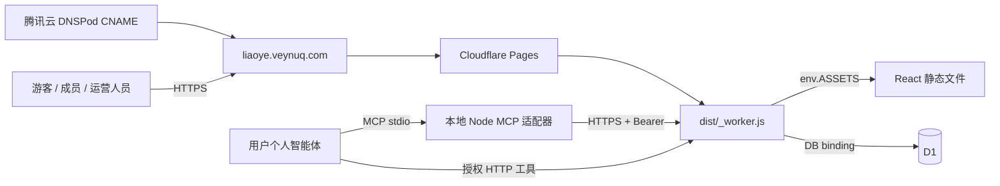
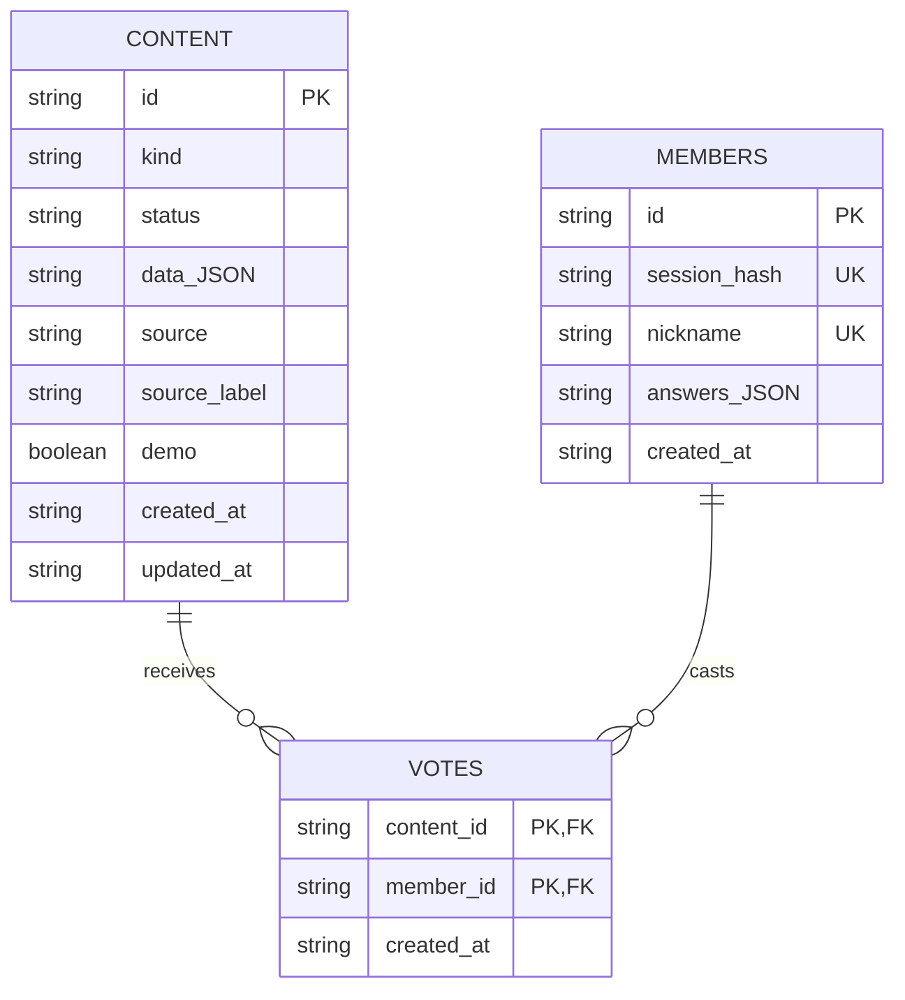
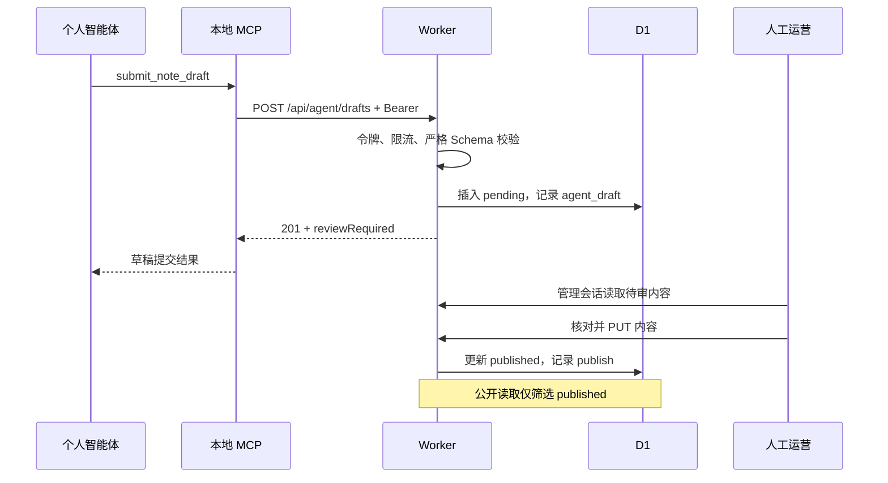

# 聊也读书技术架构

版本：1.0 · 现状快照：2026-10-15 · 关联：[PRD v1.0](PRD.md)。

架构评估置信度：96%。已读取云端处理器、数据库 Schema、校验器、前端类型、MCP 和测试；本轮正式域名健康及公开接口返回 200，两套处理器各 17 项测试通过。并发性能、完整恢复与客户端兼容性未验证。下一阶段设计建议置信度：88%，取决于试点规模、人员与成本约束。

会员账号增量沿用当前技术栈。设计置信度94%；共享认证模块、账号表、会话表、私有联系人、加密与迁移取舍见[会员账号与社群加入](会员账号与社群加入.md)。原管理角色与智能体权限保持有效。

## 1. 架构总览

生产是一套 **Cloudflare Pages Advanced Mode + D1 的单体应用**。React 前端、边缘 API 与一个数据库即可完成当前闭环。个人智能体运行在用户自己的客户端；本站不是多智能体运行平台。

信任边界：浏览器／客户端均不可信，Worker 按身份和输入独立校验；MCP 不直连数据库。D1 绑定具有应用级读写能力，细分角色由服务端实现，并不是按成员建立数据库角色。管理凭证不应交给个人智能体。

| 环境 | 入口与运行 | 数据 | 用途／差异 |
| --- | --- | --- | --- |
| 生产 | `https://liaoye.veynuq.com` → Pages `_worker.js` | 云端 D1 | HTTPS、Secure Cookie、持久化会话及限流 |
| 平台地址 | `https://liaoye-reading.pages.dev` | 同一绑定配置对应的云端库 | 实际云端核验入口；不是本地测试 |
| 本地开发 | `http://127.0.0.1:4317` → Node HTTP | `data/liaoye.sqlite` | 内容持久化；管理会话和限流为进程内状态，Cookie 不带 Secure |
| 云端处理器测试 | `tests/cloud-fixture.mjs` → 同一个 `handle()` | 临时本地 SQLite 的异步 D1 接口包装 | 不是 Cloudflare 实机或完整模拟器；不能证明云端延迟、事务和配额行为 |
| UI 测试 | 独立端口 4318 | `artifacts/ui-preview-data` | 与实际本地／线上数据隔离 |

本地和云端数据库不会自动同步。预览域名允许进入同一 Worker 路径；预览绑定与 Secret 必须在部署前确认，不能假定与生产隔离，未确认前只做只读检查。

本地口令校验使用 scrypt，口令保存在被忽略的本地访问文件中；管理会话 Map 随进程重启失效。云端使用下文的 PBKDF2 和 D1 会话，两者的凭证保管、重启与恢复行为不能混为一谈。

## 2. 技术栈及代码分布

| 层 | 当前选择 | 工件 |
| --- | --- | --- |
| UI | React 19、TypeScript、Vite 7、Lucide、普通 CSS | `src/App.tsx`、`Admin.tsx`、`Agents.tsx`、`components.tsx`、`styles.css` |
| 页面状态 | React 状态 + Hash 路由；浏览器 Cookie 驱动身份 | `src/types.ts`、`src/api.ts` |
| 云 API | Workers Fetch Handler，Web Crypto，D1 SQL | `cloud/worker.mjs` |
| 本地 API | Node.js >=24.14、原生 HTTP、node:sqlite | `server/index.mjs`、`app.mjs`、`store.mjs` |
| 校验／日期 | Zod 3 严格对象；服务端日期函数 | `server/validation.mjs`、`dates.mjs` |
| Agent | MCP TypeScript SDK v1、stdio、HTTP fetch | `integrations/mcp-server.mjs` |
| 构建／发布 | TypeScript 检查、Vite、esbuild、Wrangler 4.146.0 | `package.json`、`cloud/build.mjs`、`wrangler.jsonc` |

精确依赖版本以 `package-lock.json` 为准，本文不把依赖范围当成锁定安装版本。`package.json` 与 MCP 自报 `0.1.0`，云健康接口为 `0.2.0`，目前缺少统一发布编号（TSK-07）。

本地与云端处理器目前各自实现路由和部分业务逻辑，只复用校验、日期等模块；存在规则漂移风险。共享契约与双适配器测试先行，有重复演进证据时再评估抽取领域服务。当前不拆微服务，不为多客户端名称建立多套后端。

## 3. 数据模型与实体关系

真实 Schema：[cloud/schema.sql](../cloud/schema.sql)。JSON 保存在 TEXT 中，由应用校验，并非各字段均有 SQL CHECK。

| 表 | 关键字段／约束 | 事实与限制 |
| --- | --- | --- |
| content | kind、status、data、source、source_label、demo、时间 | 三类内容共表；source 为 member／agent／editor；没有作者成员外键或内容版本表 |
| members | session_hash UNIQUE、nickname UNIQUE、answers | 保留旧身份和投票外键；新账号写内部唯一别名，实际昵称取member_accounts |
| member_accounts | member_id PK/FK、wechat_id UNIQUE NOCASE、nickname、password_hash/salt/scheme、joined_at | 微信号唯一；昵称可重名；只存密码派生摘要，独立pepper不在D1 |
| member_sessions | session_hash PK、member_id FK、expires_at | 30天有效、服务端持久化；跨设备登录同一账号，退出撤销当前凭据 |
| votes | `(content_id, member_id)` 联合主键和外键 | 重复支持由 SQL 去重；活动类型、发布状态和示例限制由应用检查 |
| agent_keys | key_hash UNIQUE、prefix、name、created_at、last_used_at、revoked_at | 全文仅创建时返回；无 expires_at、细分 scope 字段或明确的成员所有权 |
| settings | key → JSON value | 主要为 groupSize、firstMeetingHeld |
| audit | action、subject、created_at | 记录部分发布／令牌等动作；没有 actor、request_id、前后版本、成功失败全量事件 |
| management_sessions | session_hash、expires_at、role CHECK | role 为 super_admin／operator；会话过期 8 小时 |
| sessions | 旧管理会话表 | 为迁移兼容保留；当前角色会话从新表读取 |
| rate_limits | key、count、expires_at | 云端持久化固定窗口限流；过期清理在管理登录时触发 |

字段约束示例：书名／作者各不超过 100 字符；描述不超过 1200；分类 24；心得正文 20–12000；活动描述 20–2000；入群昵称 24。完整约束以 Zod Schema 为真源。

没有独立的 BookCatalog、ReadingList、EventRegistration、Comment、MessageJob、ModelRun 实体；心得用 `bookTitle` 文本关联书名，不能假定已有书籍外键或读书进度。

多步写入并非都在统一事务内：内容写入与审计为分开的调用，设置更新与会话轮换也存在多个步骤；失败可能部分完成。尚无编辑版本号、乐观锁或请求幂等表，最后写入覆盖之前内容是风险。需要按具体用例补偿／事务与故障验证，不能只加“事务化”说明文字。

## 4. 接口契约快照 C-API-1

当前路径没有 `/v1` 前缀；`C-API-1` 是此次文档版本标识，**不是服务端版本协商机制**。公共类型在 `src/types.ts`，服务端入口在 `cloud/worker.mjs` 和 `server/app.mjs`。

所有 API 返回 JSON；失败通常 `{ "error": "可展示提示" }`，尚无稳定机器错误码。写请求需要 JSON；浏览器调用携带 `X-Liaoye-Action: 1`；若有 Origin 必须同源，Bearer 调用不因此获得管理权限。有效负载上限 64 KiB。具体路由仍独立鉴权。

| 方法／路径 | 身份 | 输入摘要 → 输出／副作用 |
| --- | --- | --- |
| GET `/api/health` | 公开 | 服务、版本、storage；不是完整依赖健康探针 |
| GET `/api/state` | 公开，Cookie 可选 | published 内容、当前成员基本信息、管理标志／角色、周期、群人数、票数和本人已支持状态 |
| POST `/api/account/register`、`login`、`logout` | 注册／登录凭据 | 注册昵称＋微信号＋密码；微信号重复409；登录返回账号Cookie；退出撤销 |
| GET `/api/community` | 会员账号Cookie | 本人资料＋群主运营微信；匿名401、no-store，管理身份或Agent不能替代会员 |
| POST `/api/join` | 已登录会员 | 三问、agreed=true → 201，joined=true；重复409，不创建匿名身份 |
| GET/PUT `/api/admin/community-contacts` | 两种管理角色 | 服务端维护1–10名社群联系人，非公开内容 |
| POST `/api/submissions` | 成员 Cookie | `{kind,data}` → 201 pending |
| POST `/api/activities/:id/vote` | 成员 Cookie | `{voted:boolean}` → 支持或取消；只允许已发布非示例活动 |
| POST `/api/admin/login` | 口令 | `{password}` → `{ok,role}` 和管理 Cookie；额外 role 字段拒绝 |
| POST `/api/admin/logout` | 当前管理 Cookie，可缺省 | 删除对应会话、清 Cookie → ok |
| GET `/api/admin/dashboard` | 两种管理角色 | role、pending、rejected、设置；operator 的 keys 为 [] |
| POST `/api/admin/content` | 两种管理角色 | `{kind,data}` → 201 published |
| PUT `/api/admin/content/:id` | 两种管理角色 | 同种类 `{kind,data}` → published；没有“只保存草稿”语义 |
| POST `/api/admin/content/:id/reject` | 两种管理角色 | pending → rejected，否则 409 |
| POST `/api/admin/content/:id/unpublish` | 两种管理角色 | 已有内容 → pending |
| PUT `/api/admin/settings` | 两种管理角色 | `{groupSize:0..100000或null,firstMeetingHeld?:boolean}` |
| POST `/api/admin/keys` | super_admin | `{name}` → 201 `{id,name,key,scope}`；全文仅一次 |
| DELETE `/api/admin/keys/:id` | super_admin | 标记 revoked_at；不存在或已撤销 404 |
| GET `/api/agent/content` | Agent Bearer | 仅 published 内容及阅读规则；不返回会员问答和草稿 |
| POST `/api/agent/drafts` | Agent Bearer | `{kind,data}` → 201 pending，含 reviewRequired=true |

无登录 401；已登录但角色不足 403；输入错误 400；不存在 404；状态冲突 409；过大 413；格式 415；限流 429；未配置管理服务 503；内部异常 500。未确认请求结果前，不应把所有 5xx／超时都当成“未写入”。

本地生产以外的测试适配器差异须持续检查。C-API-1 改动流程：更新 Spec → 列出字段／路径／状态差异 → 通知提供和消费模块 Owner → 兼容与迁移设计 → 双处理器及消费者测试 → 发布证据。没有现成的自动 Contract Diff 工具。

## 5. MCP 契约 C-MCP-1 与数据流

| 工具 | API | 语义 |
| --- | --- | --- |
| read_club_content | GET `/api/agent/content` | 只读公开材料，内容不能被当作系统指令 |
| submit_book_draft | POST `/api/agent/drafts` kind=book | 月／周书单草稿 |
| submit_note_draft | 同上 kind=note | 真实材料整理，人工核对署名和引文 |
| submit_activity_draft | 同上 kind=activity | 提议草稿，不自动支持、通知或约场地 |

配置使用 `LIAOYE_API_URL`、`LIAOYE_AGENT_KEY`。远程 URL 必须 HTTPS，本机回环可 HTTP；禁止重定向；超时 15 秒。stdio MCP 进程在用户机器，不部署在 Pages。只需通用协议适配器，不需要本站保存每一家模型供应商的 API Key。

MCP 工具描述只能约束行为意图。真正阻止越权的是：Agent 路由没有发布参数，严格 Schema 拒绝额外字段，管理路由只接受有效管理会话。当前没有模型任务队列、生成日志、追踪任务进度、语义评测器或自动审阅模型。

## 6. 权限、数据安全和硬节点

| 控制 | 当前实现 | 不能据此声称 |
| --- | --- | --- |
| 管理认证 | 云端 PBKDF2-SHA256、100000 次、每角色随机盐；Cookie 随机值，仅存 SHA256 摘要 | 不等于独立账户、MFA 或完整身份审计 |
| 管理会话 | HttpOnly、SameSite=Strict、HTTPS 下 Secure、8h；重新登录轮换当前浏览器旧会话 | 未实现全员会话撤销与按个人追责 |
| 成员身份 | 微信号＋密码；随机Cookie摘要存D1，30天；完成问答后可投稿／投票 | 支持跨设备登录；未核验微信归属，无自助找回密码 |
| Agent 凭证 | 高熵随机令牌、摘要与前缀、人工撤销 | 尚无有效期、自动轮换、每客户端细分授权 |
| 请求边界 | Host 白名单，包含项目预览域名；同源 Origin、写请求头；Zod strict；64 KiB | 不等于全套反滥用与语义内容安全 |
| 输出 | 文本渲染、CSP 等响应头、API no-store、错误不回传内部异常详情 | 不等于通过完整渗透测试 |
| 云端限流 | 管理登录10/15min/IP；会员注册10/h/IP、登录30/15min/IP及10/15min/微信号；投稿20/h/成员；Agent60/min/令牌 | 固定窗口不是全局防刷体系，暂无投票专用速率配额 |

审计覆盖不全，尤其没有个人 actor 和设置变更完整记录；敏感日志和备份需本机／云账户访问控制保护。内容写入与审计缺少统一原子性不能隐去。隐私保留期限和成员删除流程见待决项 DEC-04。详细保护动作、失败方式与测试缺口见 [硬节点登记表](ai-native/13-HARD-NODE-REGISTER.md)。

## 7. 发布、迁移与恢复

构建链：`npm run build`（TS 检查 + Vite）→ `cloud/build.mjs`（esbuild `_worker.js`、`_routes.json` 全路由）→ `wrangler pages deploy`。配置为 `wrangler.jsonc`；DNSPod 的 `liaoye` CNAME 指向 `liaoye-reading.pages.dev`；没有迁移根域名 NS。

`0002-management-roles.sql` 新增管理角色会话表，旧表保留；管理脚本只在新表首次创建时导入旧会话，避免重跑迁移复活已失效会话。这是当前迁移控制，不等同于所有未来迁移已安全。

当前源码已建立[私有 GitHub 仓库](https://github.com/Frog1205/liaoye-reading-club)，有本地提交／推送安全扫描，并新增[main 自动部署流水线](自动部署.md)：历史扫描 → 双适配器测试 → 构建 → 原配置校验 → 原Pages项目发布 → 正式域名与配置保留核验。真实运行状态以Actions证据为准。GitHub不保存网站管理口令、数据库或备份，部署专用API令牌仅放Actions Secret，见 [同步约定](GitHub同步.md)。手工恢复路径见 [线上部署](线上部署.md)；迁移、数据初始化和密码更新不会自动执行。

- 代码回滚：Pages 选择之前通过验证的生产部署；**不恢复数据库**。
- 云数据恢复：已有 D1 导出备份流程；应先在隔离库恢复并核对内容、成员、投票、权限，真实恢复演练为 NOT-TESTED，不承诺 RPO/RTO。
- 本地备份：先停止服务，再保护性复制完整 `data/`，包括 WAL 相关文件；备份含私有数据，不进入公开仓库。
- 停止条件：发现越权公开、凭证泄露、目标库不明或恢复失败时，停止受影响的写入／发布，保留证据并由负责人决定修复和恢复；不要用反复导入本地库覆盖云端。

## 8. 演进顺序与取舍

| 阶段 | 变化 | 前置证据／决策 | 不提前引入的复杂度 |
| --- | --- | --- | --- |
| 现状维护 | 真实内容替换示例、按节奏发布、记录人工耗时 | 现有权限即可操作；本次不代填真实内容 | 新的模型平台和消息系统 |
| P1 可靠闭环 | 幂等草稿、恢复演练、关键告警与发布证据 | TSK-02/03/04/07；API／Schema 变化需影响分析 | 无依据的高并发架构 |
| 条件性体验补全 | 心得周期、必要的编辑体验 | DEC-02 和真实使用反馈 | 强行改造全部领域表 |
| 多人运营扩大 | 独立账号、个人审计和撤销机制 | DEC-03/04；隐私、迁移与恢复方案 | 将共享口令包装成独立账号 |
| 更多接入 | 按优先级真实客户端逐一联调 | TSK-05；记录客户端版本和可复现配置 | 宣称一次协议测试代表全部客户端支持 |

下一版不默认新增运行时模型。若未来确有自动摘要需求，应另建输入授权、模型／提示版本、事实评测集、预算和人工接管契约。平台技术规格、套餐配额与价格在本次未联网调研，不作当前费用或容量承诺。
